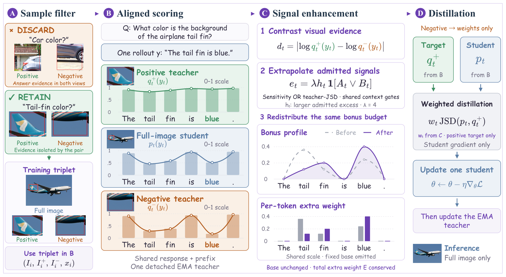

# VisAlloc

**VisAlloc: Allocating Visual Supervision for On-Policy Self-Distillation**

<p align="center">
  🤗 <a href="https://huggingface.co/Kaelyn01/VisAlloc-4B">VisAlloc-4B</a> |
  🤗 <a href="https://huggingface.co/Kaelyn01/VisAlloc-9B">VisAlloc-9B</a> |
  🗂️ <a href="https://huggingface.co/datasets/Kaelyn01/VisAlloc-6K">Training Data</a> |
  <a href="#training">Training</a> |
  <a href="#citation">Citation</a>
</p>

## Overview

VisAlloc allocates privileged visual supervision across training samples and response tokens. A fixed paired-teacher filter retains examples answered correctly from an evidence-centered positive crop and incorrectly from a spatially displaced negative crop, after annotation-quality checks. During training, the full-image student generates a response; two passes of the same detached EMA teacher score it under aligned prefixes and contrasting visual evidence.

Token-level view sensitivity supplies a continuous base weight. Sensitivity or teacher–teacher distribution disagreement admits additional weight under shared frozen-prior, template-bigram, and student–teacher JSD gates. Inverse-frequency redistribution preserves the total additional weight within each micro-batch before mean normalization. Only the positive teacher supplies the distillation target. Inference uses the full-image student.

<p align="center">
  
</p>
<p align="center"><i>Method overview from the paper. Teacher crops and token allocation are used during training; inference requires only the full image.</i></p>

<p align="center">
  
</p>

## Released Resources

| Resource | Description |
|---|---|
| [VisAlloc-4B](https://huggingface.co/Kaelyn01/VisAlloc-4B) | Qwen3.5-4B-based model, BF16 safetensors |
| [VisAlloc-9B](https://huggingface.co/Kaelyn01/VisAlloc-9B) | Qwen3.5-9B-based model, BF16 safetensors |
| [VisAlloc-6K](https://huggingface.co/datasets/Kaelyn01/VisAlloc-6K) | 6,241 source pairs and the published 5,795-sample training subset |

## Environment Setup

Training uses Linux, Python 3.12, CUDA 12.8, and four GPUs per node by default. The runtime is vendored from Vision-OPD/verl, with the VisAlloc actor integration used by the training project.

```bash
conda create -n visalloc python=3.12 -y
conda activate visalloc
python -m pip install --upgrade pip
python -m pip install torch==2.11.0 --index-url https://download.pytorch.org/whl/cu128
python -m pip install -r requirements.txt
python -m pip install -e . --no-deps
python -m pip install flash-attn==2.8.3.post1 --no-build-isolation
python -m pip install causal-conv1d==1.6.1 --no-build-isolation
```

Use CUDA-compatible builds of the compiled attention kernels. The tested Python package versions are listed in `requirements.txt`.

## Quick Start

### Deployment

Serve a released model through vLLM's OpenAI-compatible API:

```bash
vllm serve Kaelyn01/VisAlloc-4B \
  --served-model-name VisAlloc-4B \
  --tensor-parallel-size 1 \
  --gpu-memory-utilization 0.85 \
  --port 8000
```

For the larger model, replace both model names with `VisAlloc-9B`. Full `transformers` loading examples are available on the corresponding Hugging Face model cards.

### Evaluation

Start an OpenAI-compatible judge endpoint, then run:

```bash
API_BASE=http://localhost:8000/v1/ \
OPENAI_MODEL_ID=VisAlloc-4B \
JUDGE_API_BASE=http://localhost:8001/v1/ \
JUDGE_MODEL=gpt-oss-120b \
BENCHMARK=vstar,zoombench,hrbench-4k,hrbench-8k,mmvp,cv-bench,mmstar,pope \
bash eval/run_eval.sh
```

`OPENAI_API_KEY` and `JUDGE_API_KEY` configure authenticated endpoints. Evaluation defaults to greedy decoding, disabled thinking, and a 32,768-token generation cap. Additional supported tasks include MME-RealWorld EN/CN/Lite and VisualProbe. The pipeline prepares benchmark inputs, generates answers, applies rule-based matching followed by an LLM judge, and calculates accuracy. Failed inference or judge requests stop scoring so that API failures do not become incorrect predictions.

## Training

### 1. Prepare the published training subset

```bash
python scripts/prepare_data.py --data-dir ./cache/visalloc-4b
```

This downloads pinned releases of VisAlloc-6K and the upstream full-image inputs, selects the published keep-ID list, verifies paired-image hashes, and writes the 5,795 retained examples in the training format. Positive and negative crops are read from the published Parquet files. The importer preserves source IDs and gives the training rows dense indices so that all three views remain aligned.

The command reconstructs the confirmed sample membership; it does not rerun the historical paired-teacher answer filtering. That protocol and the scope of the released records are documented in [VisAlloc-6K](https://huggingface.co/datasets/Kaelyn01/VisAlloc-6K/blob/main/docs/SAMPLE_FILTERING.md).

For existing downloads, pass `--release-snapshot` and `--source-dir`; the latter contains upstream `train.jsonl` and extracted `images/`. `scripts/build_candidate_views.py` provides the separate geometry-reconstruction utility for creating candidate negative views from original photographs. It produces an unfiltered candidate pool, not the final training subset.

### 2. Build frozen priors and frequency counts

The frozen artifacts are generated separately for each backbone from its own greedy, full-image responses. They are not bundled in this repository.

```bash
CUDA_VISIBLE_DEVICES=0 python scripts/prepare_priors.py \
  --data-dir ./cache/visalloc-4b \
  --model-path Qwen/Qwen3.5-4B \
  --model-revision 851bf6e806efd8d0a36b00ddf55e13ccb7b8cd0a \
  --max-new-tokens 96

python scripts/build_freq_table.py \
  --data-dir ./cache/visalloc-4b \
  --model-path Qwen/Qwen3.5-4B \
  --model-revision 851bf6e806efd8d0a36b00ddf55e13ccb7b8cd0a
```

The prior uses groups of 16 responses, a smoothed token-selection rate, and template-bigram document frequency. The frequency table counts generated token types. Validation binds these artifacts to their model, tokenizer, chat template, data manifest, and training Parquet.

### 3. Train 4B or 9B

```bash
CUDA_VISIBLE_DEVICES=0,1,2,3 MODEL_SIZE=4B \
bash scripts/run_visalloc.sh
```

For 9B, first prepare its data and backbone-specific frozen artifacts:

```bash
python scripts/prepare_data.py --data-dir ./cache/visalloc-9b

CUDA_VISIBLE_DEVICES=0 python scripts/prepare_priors.py \
  --data-dir ./cache/visalloc-9b \
  --model-path Qwen/Qwen3.5-9B \
  --model-revision c202236235762e1c871ad0ccb60c8ee5ba337b9a \
  --max-new-tokens 96

python scripts/build_freq_table.py \
  --data-dir ./cache/visalloc-9b \
  --model-path Qwen/Qwen3.5-9B \
  --model-revision c202236235762e1c871ad0ccb60c8ee5ba337b9a

CUDA_VISIBLE_DEVICES=0,1,2,3 MODEL_SIZE=9B \
bash scripts/run_visalloc.sh
```

Use the same `MODEL_PATH`/`MODEL_REVISION` when preparing artifacts and launching training. A local model directory can be used in place of a Hugging Face ID. `DATA_DIR` and `WORK_DIR` override the data and training-output directories. Additional Hydra overrides are passed through, for example `trainer.total_training_steps=2` for a short training smoke run.

| Setting | 4B | 9B |
|---|---|---|
| Base model | Qwen3.5-4B | Qwen3.5-9B |
| Retained training examples | 5,795 | 5,795 |
| Prompts / rollouts per prompt | 96 / 8 | 96 / 8 |
| Training response cap | 1,024 | 1,024 |
| Learning rate / warmup steps | 2e-6 / 10 | 2e-6 / 10 |
| Actor update budget | 60 steps | 60 steps |
| EMA rate | 0.05 | 0.05 |
| Additional-weight strength | 4.0 | 2.0 |
| Sensitivity admission | p80 | p80 |
| Teacher–teacher JSD OR admission | p90 | p90 |
| Student–teacher JSD context gate | Median | Median |
| Frequency redistribution | Enabled | Enabled |

The student-selected top-100 support includes a residual probability bucket. Quantiles, redistribution, and normalization operate within each local micro-batch; gradients accumulate before a mini-batch optimizer step, and the detached EMA teacher updates once after the actor update. Packing and parallelism therefore affect the effective algorithm.

### 4. Merge checkpoints

```bash
bash scripts/merge_checkpoint.sh \
  ./outputs/visalloc-4b/checkpoints/VisAlloc-Qwen3.5-4B/global_step_60 \
  ./outputs/VisAlloc-4B
```

The merger exports FSDP actor shards to a standard Hugging Face model directory and includes the training chat template.

## Repository Structure

```text
VisAlloc/
├── scripts/          # Published data, frozen priors, training, and model export
├── eval/             # Benchmark preparation, inference, judging, and metrics
├── verl/             # Vendored distributed runtime and VisAlloc integration
├── chat_templates/   # Shared non-thinking multimodal template
├── figures/          # Paper overview and comparison figures
├── tests/            # Data alignment, token weighting, and pipeline checks
├── CITATION.cff
└── NOTICE
```

The main integration is in `verl/workers/actor/dp_actor.py`; numerical helpers are in `verl/workers/actor/visalloc_utils.py`. Run the CPU regression suite in the configured environment with:

```bash
python -m unittest discover -s tests -v
```

## Citation

```bibtex
@misc{xu2026visalloc,
  title={{VisAlloc}: Allocating Visual Supervision for On-Policy Self-Distillation},
  author={Xu, Haoran and Chen, Tian and Wu, Yuhe and Zhao, Yanbo and Liao, Junchi and Wang, Hongyu and Li, Jiaze and Wang, Wentao and Li, Yanfeng and Qian, Rui},
  year={2026},
  url={https://github.com/Kaelyn01/VisAlloc}
}
```

## Acknowledgements and License

This implementation builds on [Vision-OPD](https://github.com/VisionOPD/Vision-OPD) and [verl](https://github.com/volcengine/verl). Upstream copyright notices are retained. See [NOTICE](NOTICE) for attribution and [LICENSE](LICENSE) for Apache-2.0 terms. The training data and underlying images retain their [component-specific terms](https://huggingface.co/datasets/Kaelyn01/VisAlloc-6K/blob/main/LICENSE.md).
