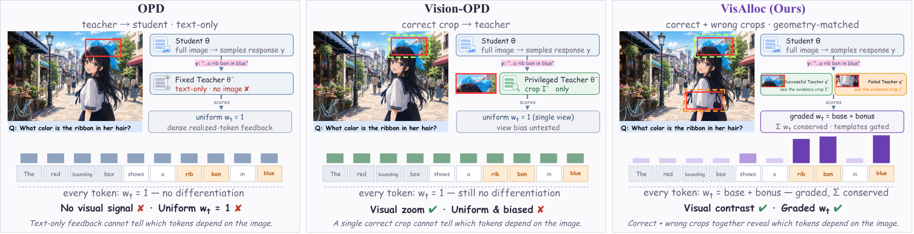

# VisAlloc: Allocating Visual Supervision for On-Policy Self-Distillation

<div align="center">

<p>Paired visual evidence for on-policy self-distillation, with full-image inference.</p>

<p>
  <a href="https://huggingface.co/Kaelyn01/VisAlloc-4B"></a>
  <a href="https://huggingface.co/Kaelyn01/VisAlloc-9B"></a>
  <a href="https://huggingface.co/datasets/Kaelyn01/VisAlloc-6K"></a>
</p>



<p><em>Figure 1. OPD uses text-only teacher feedback; Vision-OPD adds an evidence crop; VisAlloc contrasts paired teacher views to allocate visual supervision across response tokens.</em></p>

</div>

[Models & Inference](#released-models-and-inference) · [Method](#method) · [Repository Layout](#repository-layout) · [Installation](#installation) · [Dataset](#dataset) · [Training](#training) · [Evaluation](#evaluation) · [Citation](#citation)

## Overview

VisAlloc allocates visual supervision for on-policy self-distillation. A full-image student learns from a
positive, evidence-centered crop, while a spatially displaced negative crop helps select training samples
and construct token weights. Paired views are used only during training; inference uses the full image.
The released 4B and 9B models share a retained training subset of 5,795 examples from 6,241 candidate pairs.

## Released Models and Inference

| Model | Backbone | Format |
| --- | --- | --- |
| [VisAlloc-4B](https://huggingface.co/Kaelyn01/VisAlloc-4B) | Qwen3.5-4B | BF16 safetensors |
| [VisAlloc-9B](https://huggingface.co/Kaelyn01/VisAlloc-9B) | Qwen3.5-9B | BF16 safetensors |

After [installation](#installation), serve a released model through vLLM's OpenAI-compatible API:

```bash
vllm serve Kaelyn01/VisAlloc-4B \
  --served-model-name VisAlloc-4B \
  --tensor-parallel-size 1 \
  --gpu-memory-utilization 0.85 \
  --port 8000
```

For the larger model, use `Kaelyn01/VisAlloc-9B` with `--served-model-name VisAlloc-9B`. Full `transformers`
loading examples are available on the corresponding Hugging Face model cards. Inference uses the full image.

## Method

<div align="center">
  
  <p><em>Figure 2. VisAlloc constructs and filters paired views, scores a shared student response, allocates token weights, and distills the positive teacher into the full-image student.</em></p>
</div>

### Sample-level signal filtering

Each candidate pairs an evidence-centered positive crop with one fixed negative crop. Negative-view construction
reconstructs the official positive crop pixel-exactly, then displaces the target box to an intersection-over-union
below 0.1 with its original location. Both views preserve the crop dimensions, within-crop box geometry,
5-pixel frame, and 2× LANCZOS resizing. The fixed paired-teacher answer filter is applied after annotation-quality
checks; the resulting training subset contains 5,795 examples from 6,241 source pairs.

### Token-level signal enhancement

The full-image student generates an on-policy response. Two passes of the same detached EMA teacher score
that response under aligned prefixes, once with each crop. The difference in realized-token log probabilities
measures view sensitivity and supplies the continuous base weight.

Additional weight is admitted when sensitivity exceeds its p80 threshold **or** teacher–teacher JSD exceeds its
p90 threshold, under shared frozen-prior, template-bigram, and student–teacher JSD context gates. Inverse-frequency
redistribution directs additional weight toward low-frequency token types while conserving the total bonus
within the local micro-batch. Zero-budget batches retain zero bonus; the final token weights are mean-normalized.

### Positive-target distillation

Only the positive teacher supplies the JSD target, using the student's top-100 support plus a residual probability
bucket. Quantiles, bonus redistribution, and normalization operate within each local micro-batch. Gradients
accumulate before a mini-batch optimizer step, and the detached EMA teacher updates once after the actor update.
Packing and parallelism are therefore part of the effective training configuration.

## Repository Layout

```text
VisAlloc/
├── scripts/                        # Data preparation and training
│   ├── prepare_data.py             # Import the released training subset
│   ├── build_candidate_views.py    # Construct candidate crop pairs
│   ├── prepare_priors.py           # Build frozen response priors
│   ├── build_freq_table.py         # Count generated token types
│   ├── validate_priors.py          # Validate artifact identities
│   ├── resolve_model.py            # Resolve pinned model snapshots
│   ├── run_visalloc.sh             # Launch 4B or 9B training
│   └── merge_checkpoint.sh         # Export Hugging Face checkpoints
├── eval/                           # Benchmark evaluation
│   ├── prepare_data.py             # Prepare benchmark inputs
│   ├── infer.py                    # Generate model answers
│   ├── judge_qwenlm.py             # Judge generated answers
│   ├── cal_acc.py                  # Calculate benchmark accuracy
│   └── run_eval.sh                 # Run the evaluation pipeline
├── verl/                           # Vendored runtime; selected files shown
│   ├── workers/actor/
│   │   ├── dp_actor.py             # Teacher scoring and distillation
│   │   └── visalloc_utils.py       # Token weighting and redistribution
│   └── trainer/config/
│       └── visalloc.yaml           # VisAlloc training configuration
├── chat_templates/                 # Shared non-thinking chat template
├── figures/                        # Paper figures in PNG and PDF
├── docs/                           # Third-party attribution
├── tests/                          # Data, weighting, and pipeline checks
├── requirements.txt                # Reproduction dependencies
├── pyproject.toml                  # Package metadata
└── LICENSE                         # Apache-2.0 code license
```

The main entry points are the [training launcher](scripts/run_visalloc.sh) and
[evaluation pipeline](eval/run_eval.sh). The VisAlloc actor integration is in
[dp_actor.py](verl/workers/actor/dp_actor.py) and [visalloc_utils.py](verl/workers/actor/visalloc_utils.py).

## Installation

### Environment

- Linux, Python 3.12, and CUDA 12.8.
- Four GPUs per node for the default training configuration.
- PyTorch 2.11.0, Transformers 5.16.1, vLLM 0.26.0, and Ray 2.53.0. The tested Python package versions are listed
  in [requirements.txt](requirements.txt).
- CUDA-compatible FlashAttention and causal-convolution kernels for the Qwen3.5 backbones.

The runtime is vendored from Vision-OPD/verl, with the VisAlloc actor integration used by the training project.
The 4B and 9B models use Qwen3.5-4B and Qwen3.5-9B, respectively.

### Setup

```bash
git clone https://github.com/Kaelyn01/VisAlloc.git
cd VisAlloc

conda create -n visalloc python=3.12 -y
conda activate visalloc
python -m pip install --upgrade pip
python -m pip install torch==2.11.0 --index-url https://download.pytorch.org/whl/cu128
python -m pip install -r requirements.txt
python -m pip install -e . --no-deps
python -m pip install flash-attn==2.8.3.post1 --no-build-isolation
python -m pip install causal-conv1d==1.6.1 --no-build-isolation
```

### Verify the installation

Run the CPU regression suite in the configured environment:

```bash
python -m unittest discover -s tests -v
```

## Dataset

[VisAlloc-6K](https://huggingface.co/datasets/Kaelyn01/VisAlloc-6K) releases the paired teacher views and the
sample membership used for training. The original full images are obtained from the upstream Vision-OPD-6K
release during data preparation.

| Collection | Examples | Contents |
| --- | --- | --- |
| Source candidate pool | 6,241 | Paired positive and negative crops |
| Retained training subset | 5,795 | Published keep IDs used by both 4B and 9B |

```bash
python scripts/prepare_data.py --data-dir ./cache/visalloc-4b
```

The importer downloads pinned releases of VisAlloc-6K and the upstream full-image inputs, selects the published
keep-ID list, verifies paired-image hashes, and writes the retained examples in the training format. Positive and
negative crops are read from the published Parquet files. Source IDs are preserved, and dense training-row
indices keep the full image and both teacher views aligned.

This command imports the published sample selection. The historical paired-teacher filtering protocol is
documented in [SAMPLE_FILTERING.md](https://huggingface.co/datasets/Kaelyn01/VisAlloc-6K/blob/main/docs/SAMPLE_FILTERING.md).
For existing downloads, pass `--release-snapshot` and `--source-dir`; the latter contains upstream `train.jsonl`
and extracted `images/`. The separate `scripts/build_candidate_views.py` utility regenerates an unfiltered
candidate pool from original photographs.

## Training

Import the [dataset](#dataset), prepare backbone-specific priors and token counts, launch training,
and export the actor checkpoint. The commands below use the pinned 4B and 9B model revisions.

### Prepare 4B artifacts

Generate the frozen artifacts separately for each backbone from its own greedy, full-image responses:

```bash
CUDA_VISIBLE_DEVICES=0 python scripts/prepare_priors.py \
  --data-dir ./cache/visalloc-4b \
  --model-path Qwen/Qwen3.5-4B \
  --model-revision 851bf6e806efd8d0a36b00ddf55e13ccb7b8cd0a \
  --max-new-tokens 96

python scripts/build_freq_table.py \
  --data-dir ./cache/visalloc-4b \
  --model-path Qwen/Qwen3.5-4B \
  --model-revision 851bf6e806efd8d0a36b00ddf55e13ccb7b8cd0a
```

The prior uses groups of 16 responses, a smoothed token-selection rate, and template-bigram document frequency.
The frequency table counts generated token types. Validation binds these artifacts to their model, tokenizer,
chat template, data manifest, and training Parquet.

### Train VisAlloc-4B

```bash
CUDA_VISIBLE_DEVICES=0,1,2,3 MODEL_SIZE=4B \
bash scripts/run_visalloc.sh
```

### Train VisAlloc-9B

Prepare the same published subset and build the 9B backbone's own frozen artifacts before launching training:

```bash
python scripts/prepare_data.py --data-dir ./cache/visalloc-9b

CUDA_VISIBLE_DEVICES=0 python scripts/prepare_priors.py \
  --data-dir ./cache/visalloc-9b \
  --model-path Qwen/Qwen3.5-9B \
  --model-revision c202236235762e1c871ad0ccb60c8ee5ba337b9a \
  --max-new-tokens 96

python scripts/build_freq_table.py \
  --data-dir ./cache/visalloc-9b \
  --model-path Qwen/Qwen3.5-9B \
  --model-revision c202236235762e1c871ad0ccb60c8ee5ba337b9a

CUDA_VISIBLE_DEVICES=0,1,2,3 MODEL_SIZE=9B \
bash scripts/run_visalloc.sh
```

Use the same `MODEL_PATH`/`MODEL_REVISION` when preparing artifacts and launching training. A local model
directory can be used in place of a Hugging Face ID. `DATA_DIR` and `WORK_DIR` override the data and training-output
directories. Additional Hydra overrides are passed through, for example `trainer.total_training_steps=2`
for a short training smoke run.

### Training configuration

Settings of the [released training launcher](scripts/run_visalloc.sh):

| Setting | 4B | 9B |
| --- | --- | --- |
| Base model | Qwen3.5-4B | Qwen3.5-9B |
| Retained training examples | 5,795 | 5,795 |
| Prompts per training batch | 96 | 96 |
| Rollouts per prompt | 8 | 8 |
| Training response cap | 1,024 | 1,024 |
| Learning rate | 2e-6 | 2e-6 |
| Warmup steps | 10 | 10 |
| Actor update budget | 60 steps | 60 steps |
| EMA rate | 0.05 | 0.05 |
| Additional-weight strength | 4.0 | 2.0 |
| Sensitivity admission | p80 | p80 |
| Teacher–teacher JSD OR admission | p90 | p90 |
| Student–teacher JSD context gate | Median | Median |
| Frequency redistribution | Enabled | Enabled |

### Export checkpoints

```bash
bash scripts/merge_checkpoint.sh \
  ./outputs/visalloc-4b/checkpoints/VisAlloc-Qwen3.5-4B/global_step_60 \
  ./outputs/VisAlloc-4B
```

The merger exports FSDP actor shards to a standard Hugging Face model directory and includes the training
chat template.

## Evaluation

Keep the [model server](#released-models-and-inference) running and start a separate OpenAI-compatible
judge endpoint, then run:

```bash
API_BASE=http://localhost:8000/v1/ \
OPENAI_MODEL_ID=VisAlloc-4B \
JUDGE_API_BASE=http://localhost:8001/v1/ \
JUDGE_MODEL=gpt-oss-120b \
BENCHMARK=vstar,zoombench,hrbench-4k,hrbench-8k,mmvp,cv-bench,mmstar,pope \
bash eval/run_eval.sh
```

`OPENAI_API_KEY` and `JUDGE_API_KEY` configure authenticated endpoints. Evaluation defaults to greedy decoding,
disabled thinking, and a 32,768-token generation cap. Additional supported tasks include MME-RealWorld
EN/CN/Lite and VisualProbe. The pipeline prepares benchmark inputs, generates answers, applies rule-based
matching followed by an LLM judge, and calculates accuracy. Failed inference or judge requests stop scoring
so that API failures do not become incorrect predictions.

By default, predictions are saved under `eval/model_answer/<benchmark>/` and judged answers under
`eval/judge/<benchmark>/`. Set `OUT_DIR` to change the prediction directory; relative paths are resolved
from `eval/`. Accuracy is printed after each benchmark.

## Citation

If you use VisAlloc in your research, please cite:

```bibtex
@misc{xu2026visalloc,
  title = {{VisAlloc}: Allocating Visual Supervision for On-Policy Self-Distillation},
  author = {Xu, Haoran and Chen, Tian and Wu, Yuhe and Zhao, Yanbo and Liao, Junchi and Wang, Hongyu and Li, Jiaze and Wang, Wentao and Li, Yanfeng and Qian, Rui},
  year = {2026},
  url = {https://github.com/Kaelyn01/VisAlloc}
}
```

## Acknowledgements and License

This implementation builds on [Vision-OPD](https://github.com/VisionOPD/Vision-OPD) and
[verl](https://github.com/volcengine/verl). Upstream copyright notices are retained. See [NOTICE](docs/NOTICE)
for attribution and [LICENSE](LICENSE) for Apache-2.0 terms. The training data and underlying images retain
their [component-specific terms](https://huggingface.co/datasets/Kaelyn01/VisAlloc-6K/blob/main/LICENSE.md).
